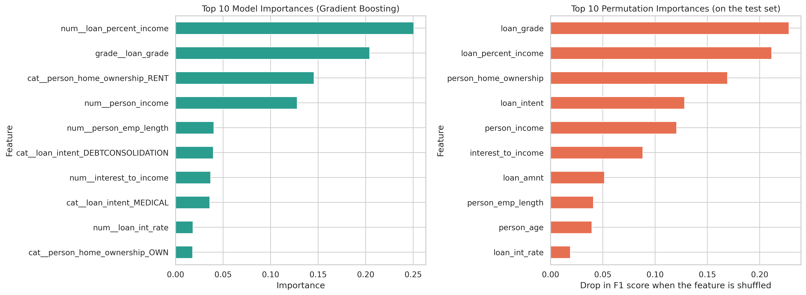
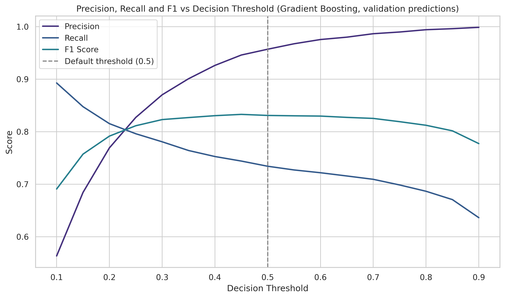
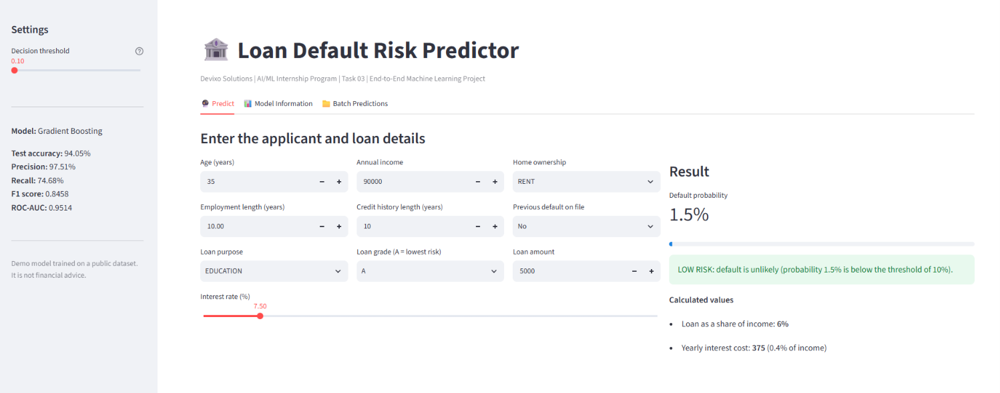
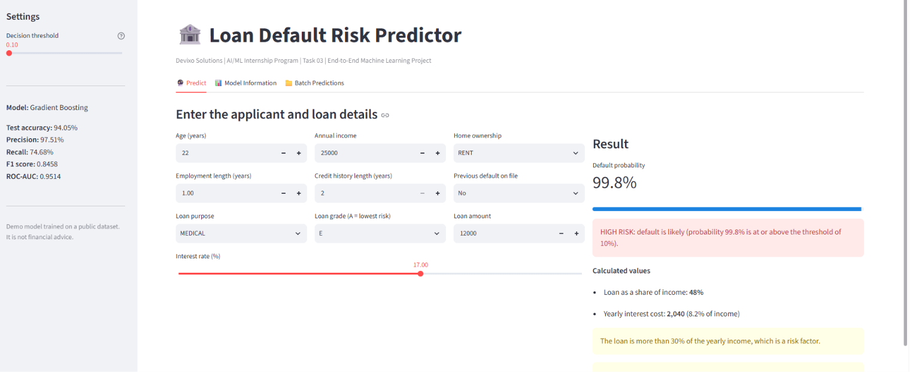

# Loan Default Prediction: End-to-End Machine Learning Project

**Devixo Solutions | AI/ML Internship Program | Task 03: End-to-End Machine Learning Project**

**Author:** Aman Khan  
**Internship Domain:** AI/ML

## Project Objective
To build a complete machine learning project from data preparation to model evaluation, optimization and saving, using a reusable scikit-learn pipeline. The problem is to predict whether a loan applicant will **default** before the loan is granted.

## Dataset Description
The Credit Risk dataset contains 32,581 loan applicants and 12 columns: borrower information (age, income, home ownership, employment length), loan information (purpose, grade, amount, interest rate, loan as a percentage of income) and credit history. The target `loan_status` is 1 when the loan ended in default (about 21.8% of the loans). After removing 165 duplicates and 7 rows with impossible values (age up to 144, employment length of 123 years), 32,409 rows remained.

## Dataset Source
Kaggle: [Credit Risk Dataset](https://www.kaggle.com/datasets/laotse/credit-risk-dataset) by Lao Tse.

## Technologies Used
Python 3, Google Colab, Jupyter Notebook, Streamlit, GitHub

## Libraries Used
Pandas, NumPy, Matplotlib, Seaborn, Scikit-learn, XGBoost, Joblib, Pickle, Streamlit

## Project Workflow
Data Preparation → Reusable Pipeline → Model Development → Model Optimization → Saving the Best Model → Documentation → Streamlit Interface

1. **Data preparation:** removed duplicates and impossible values, engineered 4 features (`emp_to_age_ratio`, `interest_cost`, `interest_to_income`, `age_group`), stratified 80/20 split.
2. **Pipeline:** median imputation, ordinal encoding of `loan_grade`, one-hot encoding of other categories, scaling, and feature selection with an ANOVA F-test (27 features reduced to 25). Everything is fitted on the training data only.
3. **Models:** Decision Tree, Random Forest, Gradient Boosting, SVM and XGBoost, each trained as a complete pipeline.
4. **Optimization:** 5-fold cross-validation, hyperparameter tuning (GridSearchCV and RandomizedSearchCV), feature importance (model and permutation) and a decision threshold analysis.
5. **Saving:** the best pipeline was saved with **Joblib and Pickle** and verified by reloading it.

## Results

### Default settings (test set)
| Model | Accuracy | Precision | Recall | F1 Score | ROC-AUC |
|---|---|---|---|---|---|
| XGBoost | 0.9397 | 0.9849 | 0.7355 | 0.8421 | 0.9499 |
| Random Forest | 0.9352 | 0.9699 | 0.7264 | 0.8306 | 0.9367 |
| Gradient Boosting | 0.9310 | 0.9500 | 0.7228 | 0.8210 | 0.9325 |
| Decision Tree | 0.8936 | 0.7398 | 0.7920 | 0.7650 | 0.8570 |
| SVM | 0.9101 | 0.9196 | 0.6453 | 0.7584 | 0.8937 |

### After hyperparameter tuning (test set)
| Model | Accuracy | Precision | Recall | F1 Score | ROC-AUC |
|---|---|---|---|---|---|
| **Gradient Boosting** | **0.9405** | 0.9751 | 0.7468 | **0.8458** | **0.9514** |
| XGBoost | 0.9389 | 0.9758 | 0.7391 | 0.8411 | 0.9511 |
| Random Forest | 0.9371 | 0.9819 | 0.7257 | 0.8345 | 0.9392 |
| Decision Tree | 0.9347 | 0.9752 | 0.7200 | 0.8284 | 0.9183 |

## Major Findings
- **Selected model: tuned Gradient Boosting** (F1 0.8458, accuracy 94.05%, ROC-AUC 0.9514), compared with 78.18% accuracy for always predicting "no default". XGBoost is almost identical and about five times faster to tune.
- Tuning gave the largest gain to the Decision Tree (F1 +0.0634), because limiting its depth from 33 to 8 removed its overfitting.
- The most important inputs are the loan grade, the loan amount as a percentage of income, home ownership, loan purpose and income. The engineered feature `interest_to_income` is also among the most important ones.
- The saved Joblib and Pickle pipelines give predictions identical to the original model and accept raw customer data.

## Limitations
- About a quarter of the real defaults are not detected at the default threshold (recall about 75%).
- Only 11 input columns are available (no credit score, debts or payment history), and the dataset is a public sample of mostly young borrowers.
- Loan grade and interest rate are assigned by the lender, so they must be known before the model can be used.
- One fixed train-test split was used, no time-based validation, and fairness across groups was not checked.

## Future Improvements
Add more informative features, choose the threshold from real costs, calibrate probabilities and explain decisions with SHAP, check fairness, try techniques for imbalanced data (for example SMOTE), a wider hyperparameter search and model stacking, and deploy the pipeline as an API with monitoring.

## Screenshots
| Feature importance | Threshold analysis |
|---|---|
|  |  |

| Prediction interface (low risk) | Prediction interface (high risk) |
|---|---|
|  |  |

## Project Structure
```
Task_03_AI_ML/
├── dataset/        credit_risk_dataset.csv
├── notebook/       Task_03_End_to_End_ML.ipynb
├── models/         credit_risk_pipeline.joblib, credit_risk_pipeline.pkl, model_info.json
├── app/            app.py (Streamlit interface)
├── images/         charts and result tables
├── requirements.txt
└── README.md
```

## How to Run the Project
1. Clone the repository:
   ```
   git clone https://github.com/Amankhan987/Task_03_AI-ML_Loan_Default_Prediction.git
   cd Task_03_AI-ML_Loan_Default_Prediction
   ```
2. Install the libraries (the saved model needs scikit-learn 1.6.1):
   ```
   pip install -r requirements.txt
   ```
3. **Notebook:** open `notebook/Task_03_End_to_End_ML.ipynb` in Jupyter or Google Colab. Change `PATH`, `IMG` and `MODELS` in the notebook to your local folders if you do not use Google Drive.
4. **Prediction interface:** run from the project root folder:
   ```
   streamlit run app/app.py
   ```
   Live app: [your-streamlit-link]

## Author
**Aman Khan** | AI/ML Intern, Devixo Solutions
